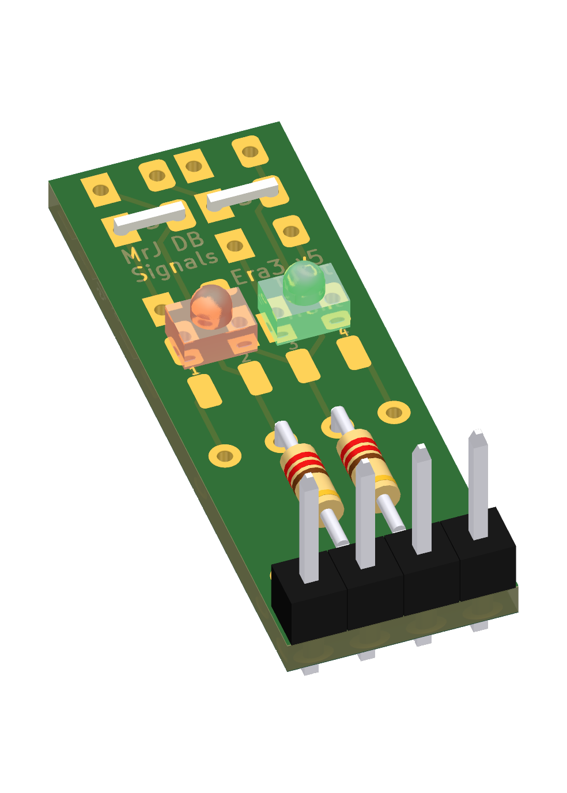
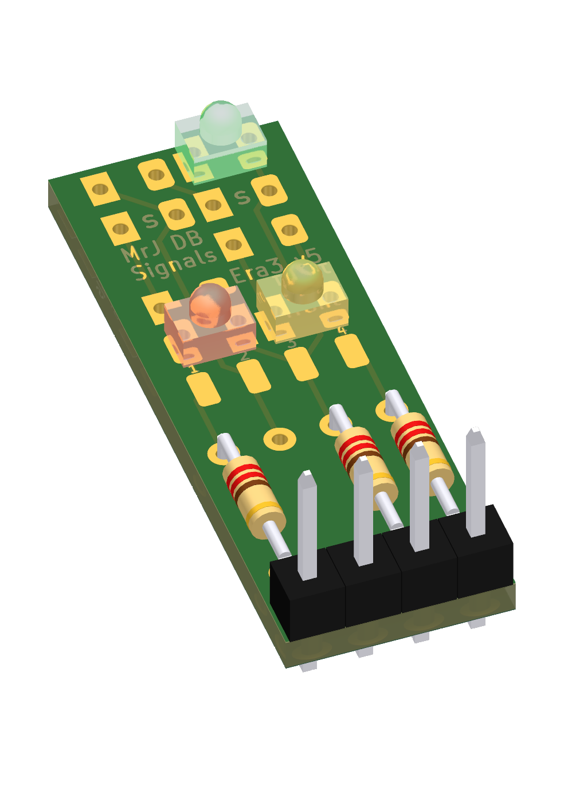
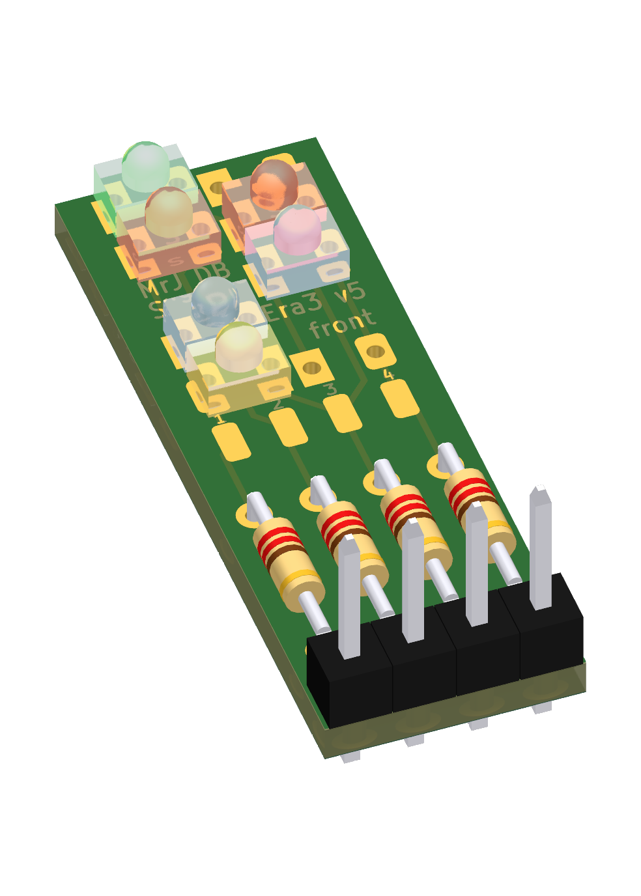

# Railway HO project Signals and electronics for my HO scale railway project

This is my own project for building model railway HO scale (1:87) Deutsche Bundesbahn (DB) style Era III (1945-1970) Train Signals following this specification.

This is part of a complete project involving:

- 3D printing: the signal bodies, 3 faces ([Maker World](https://makerworld.com/en/models/682526-mrj-ho-scale-db-signals-era-iii-3x-faces))
- Electronics (PCB design and soldering) ([github](https://github.com/HO44-PROJECT/MrJ-HO-scale-DB-style-Era-III-Train-Signals-Electronics))
- Arduino code (demo, DCC and JMRI integration) ([github](https://github.com/HO44-PROJECT/MrJ-HO-scale-DB-style-Era-III-Train-Signals-Arduino-Demo-Code))

## Another project to drive the signals

[MrJ-LayoutFX](https://github.com/HO44-PROJECT/MrJ-LayoutFX) grew out of these signals. It gives you a control
interface for an ESP32 that is driven by DCC commands and can generate lighting effects (signals, beacons, traffic
lights, campfires...) and drive other peripherals. You can flash it straight from your browser.
It is designed to work with a custom PCB with built-in DCC decoding,
[MrJ-LayoutFX-ESP32-PCB](https://github.com/HO44-PROJECT/MrJ-LayoutFX-ESP32-PCB) (ESP32 DevKitC), and also exists for
the Arduino Nano with [MrJ-LayoutFX-Nano-PCB](https://github.com/HO44-PROJECT/MrJ-LayoutFX-Nano-PCB).

This is what you will be able to build:

# What this repository provides

- the **gerber files** of the 2 PCB versions (production and breadboard), ready to send to a manufacturer
- the **wiring and test elements**: the level (VCC / GND) to apply on each wire for every signal aspect and every wiring test, and Fritzing parts to draw your circuit

**[Try the interactive 3D viewer](https://ho44-project.github.io/MrJ-HO-scale-DB-style-Era-III-Train-Signals-Electronics/documentation/prod/MrJ-DB-Era3-prod-viewer.html)**
(production PCB; the [breadboard version](https://ho44-project.github.io/MrJ-HO-scale-DB-style-Era-III-Train-Signals-Electronics/documentation/breadboard/MrJ-DB-Era3-breadboard-viewer.html) is there too).
Pick a signal, then an aspect: all LEDs off, all on, Hp0, Hp1...
The 3D view also helps you **place the LEDs**: turn the board around and see which LED goes where, and which ones
light for each aspect.

The breadboard version, for the three signals (block, entry, exit):

| Block signal | Entry signal | Exit signal |
|---|---|---|
|  |  |  |

## Production or breadboard?

Both boards have the same circuit and the same LEDs. They differ by how you connect them:

- **Production PCB**: the board that goes inside the signal. You solder your wires directly to the pads.
  This is the one to order for your layout.
- **Breadboard PCB**: the same board with pin headers, and room to solder the resistors on it.
  Plug it on a breadboard to test the wiring, the resistors and your controller (Arduino, DCC, JMRI) *before*
  building the real signals. It is a test tool, not meant to be installed on the layout.

If you only want to build the signals, order the production PCB. Order the breadboard one too if you want to test first.

## More pictures

The [images](images/) directory holds many pictures of the assembly (soldering with helpers, testing a signal,
disassembly), of the design (board, details, parts) and of the finished block, entry and exit signals.
The assembly pictures show the **procedure to follow**, in particular how to **use the jig**: a 3D printed part
that holds the LEDs and the PCB in place while you solder them.

# Resources

[wikipedia signals in Germany](https://en.wikipedia.org/wiki/Railway_signals_in_Germany)

These sites were a great source of inspiration:
* [stummi forum (DE)](https://www.stummiforum.de/t174376f21-Viessman-Signalbr-cke-mit-Arduino-gesteuert.html)
* [digital bahn (DE)] (https://www.digital-bahn.de/info_kompo/signale.htm)

# Project

This project contains Kicad project files and gerber to build PCBs using 1.8mm LEDs.

This PCB uses charlieplexing to reduce the number of wires. It is possible to build a block signal, input signal, or output signal with this PCB.
I designed my own wiring path to avoid using the POV effect to light multiple LEDs. Each situation for each signal is a simple combination of HIGH and LOW signals on all 4 pins.

It's possible to reduce the number of wires for the "Block Signal" (only 2 wires required) and the "Entry Signal" (only 3 wires required). See [documentation](documentation/).

I also need a special breadboard version to ease tests. This version allows soldering of resistors.

The **gerber.zip** files are enough to build the PCB from a manufacturer such as [jlcpcb](https://jlcpcb.com/). See the [release](release/) directory.

The PCB is designed to fit inside the 3D printed signals: see the
[3D model on Maker World](https://makerworld.com/en/models/682526-mrj-ho-scale-db-signals-era-iii-3x-faces).

# History

The version 2 is smaller than the version 1.
It solves the "shunting signal" Hp0 + Sh1 did not work because the right white LED did not light up.

This v3 is a better version as it fixes a distributed current problem.

# Repository content

| Directory | Content |
|---|---|
| [release](release/) | Gerber zips, ready to send to a PCB manufacturer (production and breadboard boards). |
| [source](source/) | KiCad 10 projects (schematic and PCB) of the two boards. |
| [library](library/) | KiCad footprints, 3D models and drawings of the 1.8 mm LEDs. |
| [documentation](documentation/) | Renders, interactive 3D viewers, and the wire levels (VCC / GND) for each signal aspect. |
| [images](images/) | Pictures of the assembly, the design and the finished signals. |
| [fritzing](fritzing/) | [Fritzing](https://fritzing.org) parts of the signals, to draw your circuit. |

The 3D printed signals themselves are on [Maker World](https://makerworld.com/en/models/682526-mrj-ho-scale-db-signals-era-iii-3x-faces).

The interactive viewers in [documentation](documentation/) must be served over http (for example from GitHub Pages).

# BOM:
* a PCB per signal. I ordered mine 0.8mm thickness from jlcpcb.com simply by uploading the gerber.zip file.
* 2 to 4 resistors 1/4 W from everywhere: 470 ohm for a 3.3 V supply, 1 kohm for a 5 V supply
* 1.8mm LEDs. I bought mine from aliexpress.com.
